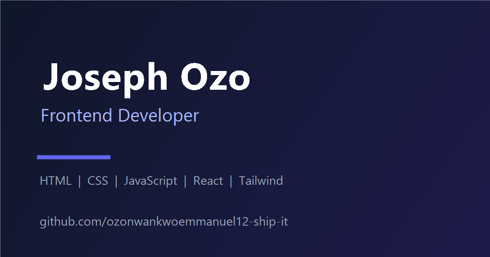

# Joseph Ozo — Personal Portfolio

A production-ready, single-page developer portfolio built with **HTML5, CSS3 and vanilla JavaScript** — no frameworks, no build step. Deploy it anywhere: GitHub Pages, Netlify, Vercel, or any static host.



## Features

- **Hero section** with typewriter role animation, availability badge, and floating skill cards
- **About section** with bio, quick facts, animated stat counters and profile media
- **Skills & technologies** grouped into cards plus a tag cloud
- **Projects section** with **all 22 public GitHub repos** — each card links to a **live demo** (GitHub Pages) and its source code
- **Services** grid
- **Contact section** with social links (GitHub + LinkedIn), location and availability
- **Responsive navigation** with an animated mobile slide-in menu, Escape/outside-click handling and body scroll lock
- **Dark / light mode** toggle with `localStorage` persistence and system-preference detection (no flash of wrong theme)
- **Smooth scrolling** with anchor offset for the fixed header
- **Scroll-reveal animations** and animated counters via IntersectionObserver (disabled for `prefers-reduced-motion`)
- **Accessibility**: skip link, semantic landmarks, ARIA labels, keyboard-friendly focus states, visible focus rings, `prefers-reduced-motion` support
- **SEO**: meta description/keywords/robots, canonical URL, Open Graph + Twitter cards, JSON-LD `Person` schema, `sitemap.xml`, `robots.txt`
- **Favicon support**: SVG + multi-size PNG favicons, apple-touch icon, PWA-style web manifest
- **404 page** styled to match

## Tech stack

| Layer | Technology |
| ----- | ---------- |
| Markup | Semantic HTML5 |
| Styling | CSS3 with custom properties (CSS variables) |
| Behavior | Vanilla JavaScript (ES6+, no dependencies) |
| Fonts | Sora (display) & Inter (body) via Google Fonts |

## Project structure

```
portfolio/
├── index.html          # Main page (all sections + SEO/OG/JSON-LD metadata)
├── 404.html            # Custom error page
├── robots.txt          # Search-engine crawl rules
├── sitemap.xml         # Sitemap for search engines
├── README.md
├── css/
│   └── styles.css      # Design system, theming, responsive layout, animations
├── js/
│   └── main.js         # Editable data config + all interactivity
└── assets/
    ├── favicon.svg, favicon-16/32.png, icon-192/512.png
    ├── apple-touch-icon.png
    ├── og-image.png    # Open Graph share image (1200×630)
    └── site.webmanifest
```

## Getting started

1. **Open locally** — just open `index.html` in a browser, or run a static server:

   ```bash
   # Python
   python -m http.server 8080

   # Node
   npx serve .
   ```

   Then visit `http://localhost:8080`.

2. **Edit your content** — all personal data (skills, projects, services, social links, typing roles) lives in the `PORTFOLIO_CONFIG` object at the top of [`js/main.js`](js/main.js).

3. **Update metadata** — the canonical URL, Open Graph URLs and the JSON-LD schema in `index.html` all reference a placeholder GitHUb-Pages base URL. Replace `https://ozonwankwoemmanuel12-ship-it.github.io/portfolio/` with your real domain (find via a comment-free search for `ozonwankwoemmanuel12-ship-it.github.io`).

## Customization quick reference

| What you want to change | Where |
| ----------------------- | ----- |
| Name, roles, bio, facts | `index.html` (hero/about sections) |
| Skills, projects, services, social links | `PORTFOLIO_CONFIG` in `js/main.js` |
| Accent color, gradients, theme palettes | CSS variables at the top of `css/styles.css` |
| Navigation links | `<nav>` blocks in `index.html` |

## Accessibility

- Skip-to-content link at the top of every page
- Semantic landmarks (`header`, `nav`, `main`, `section`, `footer`)
- Every icon button has an accessible name (`aria-label`) and correct `aria-expanded` / `aria-pressed` state
- Keyboard-focus outline is visible in both themes
- Scroll-reveal and counters respect `prefers-reduced-motion`
- Color contrast meets WCAG AA for body text in both themes

## Performance & best practices

- No third-party runtime dependencies; only fonts are loaded from Google Fonts with `preconnect`
- `loading="lazy"` / `decoding="async"` on below-the-fold images
- Theme script runs inline in `<head>` to prevent flash-of-wrong-theme
- Fixed header uses `backdrop-filter` and transitions only on scroll (via a `scrolled` class)
- Semantic HTML, valid ARIA, and a single data source of truth for content

## Deployment

### GitHub Pages

1. Push this folder to a GitHub repository (e.g. `ozonwankwwoemmanuel12-ship-it/portfolio`).
2. Repo → **Settings** → **Pages** → Source: **Deploy from a branch** → branch `main`, folder `/` (root).
3. Your site is live at `https://ozonwankwoemmanuel12-ship-it.github.io/portfolio/`.

### Netlify / Vercel

Both platforms auto-detect a static site: point them at this folder (build command: none; publish directory: `/`).

### Enabling the project live demos

Every project card can show a **Live demo** button pointing at its GitHub Pages URL. Repos with an `index.html` at the root deploy instantly — enable them per repo:

1. Open a repo → **Settings** → **Pages**.
2. Source: **Deploy from a branch** → branch `main`, folder `/ (root)` → **Save**.
3. The demo goes live at `https://ozonwankwoemmanuel12-ship-it.github.io/<repo>/`.

Notes:
- **React/Vite repos** (e.g. `Fashionise-Clone`, `Enugu-WATCH`, `Hello-Bio-main`): set `base: "/<repo>/"` in `vite.config.js` before enabling Pages, or asset paths will 404.
- **`skylark-weather`** serves from `skylark-weather-app.html`, so its demo URL uses that file explicitly.
- **Empty repos** (no files yet) show "No live demo yet" automatically — the button appears as soon as you add a `demo` URL in `js/main.js`.

### Privacy notes

- Remove any personal tokens and, if your repos contain `.env` secrets, never enable Pages on them.

## Browser support

Firefox, Chrome, Edge, and Safari — latest two versions. Uses CSS custom properties, `gap` in flexbox/grid, `backdrop-filter` (graceful fallback), and IntersectionObserver (content still renders without it).

## License

© 2026 Joseph Ozo. You're free to use this as a personal template; please replace all personal content and social links before publishing.